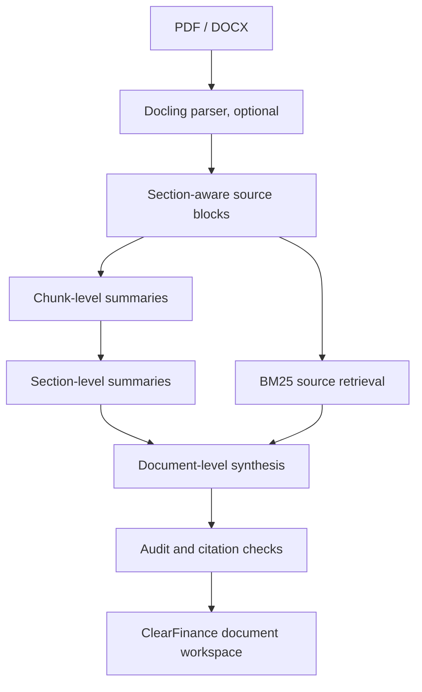

# ClearFinance Summarization Engine — V2

## Architecture



## Run locally

```bash
cd backend
python -m venv .venv
source .venv/bin/activate  # Windows: .venv\\Scripts\\activate
pip install -r requirements-docling.txt
ollama pull qwen2.5:3b
ollama serve
uvicorn app.main:app --host 127.0.0.1 --port 8000
```

The model, Docling, OCR weights and any downloads run on the developer machine. No paid API is required. First-time model downloads may be large.

- `POST /api/analyze/file`: multipart `file` PDF/DOCX → `{blocks,analysis,audit}`.
- `POST /api/parse`: multipart PDF/DOCX → structured source blocks only.
- `POST /api/analyze`: original source blocks → V2 summary.
- `POST /api/analyze/v1`: prior hierarchical implementation for controlled comparison.
- `POST /api/analyze/flat`: original flat baseline.
- `POST /api/ask`: answer questions over blocks.

The frontend's existing `/api/analyze` call is compatible. The public GitHub Pages site stays a static design demo. A locally running backend can be used via `NEXT_PUBLIC_AI_API_BASE_URL=http://127.0.0.1:8000` and `npm run dev`. The browser currently extracts PDF blocks itself: for Docling layout fidelity, use the dedicated file endpoint until frontend upload wiring is completed.

## Audit
API output includes a document fingerprint, chunk count, processed count, section count, number of model calls, warnings, completeness and coverage ratio.

Source IDs are checked against original passages, but factual entailment, critical-omission detection and model calibration still belong to the separate Evaluation Engine.

## Limits and security
- 20 MB maximum uploaded file.
- API is unauthenticated and **local-only**, not for real confidential customer data.
- Long documents can take many sequential model calls; model budget may stop generation, explicitly setting `limited=true`.
- Large PDF page images and source rectangles are not yet directly integrated with the browser viewer.
- No cloud background jobs or remote autonomous agent is running.
